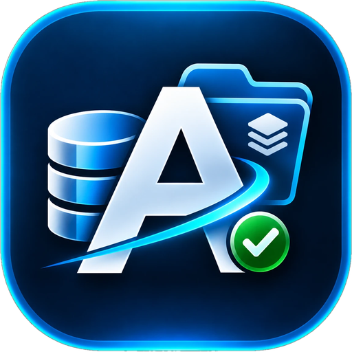

  

<h1 align="center">AdvancedSID</h1>

  Find out who owns every FSLogix profile on your share, and see at a glance which containers are locked and by which server.

  <a href="https://github.com/MXR156/AdvancedSID/releases/latest"><b>Download the latest version</b></a>

---

FSLogix and UPD profile shares are full of folders named after SIDs, and a stuck `.lock` file
can be in any one of up to four places: the User Profile, the Office container, and the Cloud
Cache copy of each. AdvancedSID scans them all at once and shows one row per user, so you can
see straight away:

- **who** each profile folder belongs to (name, AD account, enabled / disabled / deleted),
- **which** of their containers are locked, and **which session host** holds each lock,
- **which** users have a lock **mismatch**, a common cause of logon failures.

It is read-only: it never changes, moves or deletes anything on your shares.

## Features

**Lock overview**
- Every storage location is a column. A locked container shows in red with the server
  holding it, for example `LOCKED  AVD-HOST-02`. Hover over it for the full server name,
  the lock file and how long it has been locked.
- The server name is read straight from the FSLogix `.lock` file, so there's no need to open
  each one in Notepad.

**Lock mismatch detection**
- When a user is logged on, *all* of their containers are locked. If some are locked and
  others aren't (for example, Office locked but User Profile not), or they're locked by
  different servers, the user is flagged **LOCK MISMATCH** in orange. The container that
  should be locked shows `NOT LOCKED (mismatch)`.

**User lookup**
- Each SID is resolved to the Active Directory account, with display name, email,
  enabled/disabled status and approximate last logon.
- SIDs that no longer exist in AD are flagged **Orphaned**, which makes leavers' profiles easy to find.

**Works with your layout**
- User Profiles only, User + Office Profiles, either with Cloud Cache, or all four locations.
- Folder naming `SID_username` (FSLogix default), `username_SID` (FlipFlop) and UPD `UVHD-SID.vhdx`.
- Mapped drives or UNC paths (`\\server\share\Profiles`).

**Quick actions** (right-click a user or a location cell)
- Open the user's folder in Explorer. Double-click a cell does the same.
- Open a lock file in Notepad, or show it in Explorer.
- Copy the user name, SID, AD account, server name or folder paths.
- Rescan just that user, for example after a lock has been cleared.

**Finding things**
- Search by user name, display name, SID or **server name**. Type a host name to see every
  profile that host has locked.
- Filters: *Locked only*, *Lock mismatches only*, *Orphaned / disabled only*.
- The files pane lists every VHDX, `.lock` and `.meta` file for the selected user. Tick
  *Show lock files only* to see just the locks.
- The status bar shows totals; hover over it for a count of locks per session host.
- **Export CSV** saves the current list, for reports or follow-up.

## Download and run

1. Download **AdvancedSID.exe** from the [latest release](https://github.com/MXR156/AdvancedSID/releases/latest).
2. Run it. There's nothing to install, and .NET doesn't need to be installed.
3. The first time, **Configure locations** opens. Tick the options that match your FSLogix setup
   and enter the path for each location:

   | Setting                                | Paths to enter                                   |
   |----------------------------------------|--------------------------------------------------|
   | (nothing ticked)                       | User Profiles                                    |
   | Office containers enabled              | User Profiles, Office Profiles                   |
   | Cloud Cache enabled                    | User Profiles, User Profiles Cloud Cache         |
   | Both                                   | All four                                         |

4. Click **OK**. The scan starts. Press **F5** to rescan at any time, and use
   **Configure locations...** to change paths later.

> Windows SmartScreen may warn you the first time, because the EXE isn't code-signed.
> Click **More info → Run anyway**.

## What the colours mean

| Cell                         | Meaning                                                                   |
|------------------------------|---------------------------------------------------------------------------|
| `OK  2.1 GB` (green)         | Container present, not locked                                             |
| `LOCKED  HOST` (red)         | Container locked by that session host                                     |
| `NOT LOCKED (mismatch)` (orange) | User's other containers are locked but this one isn't, so investigate     |
| `No disk` (amber)            | The user's folder exists but has no VHD/VHDX in it                        |
| `-` (grey)                   | The user has no folder in this location                                   |

The **Status** column summarises each user: `OK`, `Locked`, `LOCK MISMATCH`, `Orphaned` or `Disabled`.

## Requirements

- 64-bit Windows 10 / 11 or Windows Server 2016 or later.
- Read access to the profile shares.
- For user details: a domain-joined machine. Without a domain, profiles and locks are still
  shown, but names can't be looked up.

## Tips and troubleshooting

- **Mapped drive "can't be reached":** if you run AdvancedSID *as administrator*, drives
  mapped in your normal session aren't visible to it. Run it normally, or use the UNC path
  (`\\server\share\...`).
- **"(unreadable)" as the lock server:** the session host has the lock file open
  exclusively. The container is still shown as locked.
- **Everyone shows as Orphaned on a test PC:** the PC isn't in the same domain as the SIDs.
- Your locations are saved in `%APPDATA%\AdvancedSID\settings.json`.

## Roadmap

- **Clear stuck locks** from within the app. A lock will only be removed when the user is no
  longer logged on to the server named in it.

Suggestions and bug reports are welcome. Please [open an issue](https://github.com/MXR156/AdvancedSID/issues).

---

Building from source or making a release? See [docs/DEVELOPMENT.md](docs/DEVELOPMENT.md).
